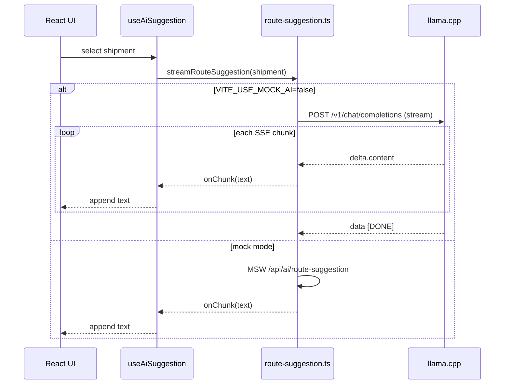
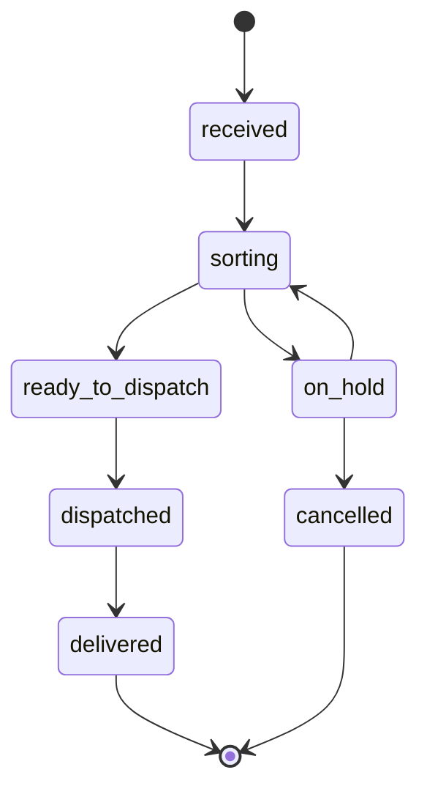

# Warehouse Shipping Analysis

Warehouse shipment tracking and shift performance analytics in a React app with API runs in the browser for shipment data. Route suggestions powered by stream data from a AI server.

Dashboard View<br>


Performance View<br>


<br>

---

## Features

- Dashboard with live stat cards, a filterable shipment table, and a shipment detail modal.
- Live updates over Server-Sent Events (new shipments, status changes, priority changes).
- Streamed route suggestions per shipment, with a warning when a suggestion conflicts with the shipment priority.
- Status transitions validated against a single state machine.
- Performance analytics: hourly throughput, status dwell time, carrier efficiency, priority mix, and zone load.
- Snackbar notifications for incoming live events.

## Tech Stack

| Layer | Choice |
| :- | :- |
| UI | React 19, MUI 9 |
| Build | Vite 8, TypeScript 6 |
| Data | TanStack Query 5 |
| Routing | React Router 7 |
| Mock API | MSW 3, development only |
| Lint | ESLint 9, typescript-eslint 8 |

## Getting Started

Requirements: Node.js 20.19+ or 22.12+, and npm.

```sh
npm install
npm run dev
```

Open the URL printed by Vite, usually http://localhost:5173.

The in-browser mock API starts automatically in development. No backend or database is needed for shipment data.

## Scripts

| Command | Purpose |
| :- | :- |
| `npm run dev` | Typecheck, then start the dev server |
| `npm run build` | Typecheck, then build to `dist/` |
| `npm run preview` | Serve the built app locally |
| `npm run lint` | Run ESLint with zero warnings allowed |

## Mock API

All endpoints are defined in `src/api/handlers.ts`.

| Endpoint | Method | Purpose |
| :- | :- | :- |
| `/api/shipments` | GET | List shipments. Accepts `status` and `priority` filters |
| `/api/shipments/stats` | GET | Dashboard aggregate counts |
| `/api/shipments/:id/status` | PATCH | Advance status after state machine validation |
| `/api/shipments/stream` | GET | SSE stream: `new_shipment`, `status_change`, `priority_update` |
| `/api/ai/route-suggestion` | POST | Stream a mock route suggestion as plain text |

The AI endpoint is only registered when `VITE_USE_MOCK_AI` is not `false`.

## Route Suggestions

Route suggestions are mocked by default. Set `VITE_USE_MOCK_AI=false` to stream them from a local llama.cpp server.

| Variable | Default | Purpose |
| :- | :- | :- |
| `VITE_USE_MOCK_AI` | `true` | `false` streams from llama.cpp |
| `VITE_LLAMA_URL` | `http://127.0.0.1:9931` | llama.cpp base URL |
| `VITE_LLAMA_MODEL` | `default` | Model alias sent to the server |

### Integration API

| Mode | Endpoint | Response |
| :- | :- | :- |
| Mock | `POST /api/ai/route-suggestion` | Plain text stream from MSW |
| Local | `POST ${VITE_LLAMA_URL}/v1/chat/completions` | SSE JSON chunks |

The local request uses the OpenAI chat completions shape:

```json
{
  "model": "default",
  "stream": true,
  "max_tokens": 128,
  "temperature": 0.3,
  "chat_template_kwargs": { "enable_thinking": false },
  "messages": [
    { "role": "system", "content": "You are a warehouse routing assistant..." },
    { "role": "user", "content": "Shipment data: {...}" }
  ]
}
```

The response is a stream of SSE lines:

```text
data: {"choices":[{"delta":{"content":"Move"}}]}
data: {"choices":[{"delta":{"content":" the package"}}]}
data: [DONE]
```

Only `choices[0].delta.content` is appended to the panel. `reasoning_content` is ignored. The request is aborted when the selected shipment changes or the panel unmounts.

The prompt sends routing fields only: id, status, priority, next statuses, destination, carrier name, weight, package count, and notes. Sender and recipient are not included.

### Request Flow



The server must expose an OpenAI-compatible `POST /v1/chat/completions` endpoint and allow the app origin. This direct browser call is intended for local use. A deployed build needs a server-side proxy. Restart Vite after changing `.env`.

## Status Flow

The state machine used by the mock API and the detail modal:



## Notes

- Mock data lives in memory. A page refresh restores the seed data.
- The mock API only starts in development. The preview build needs a real backend.
- Priority changes shown on the Performance page count only events from the current session.
- With `VITE_USE_MOCK_AI=true`, route suggestions are random. About 30% intentionally conflict with the shipment priority.
- With `VITE_USE_MOCK_AI=false`, the llama.cpp server must be running. If the request fails, the panel shows no suggestion.

<br>

---

###### end of readme
